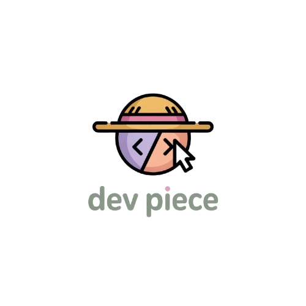
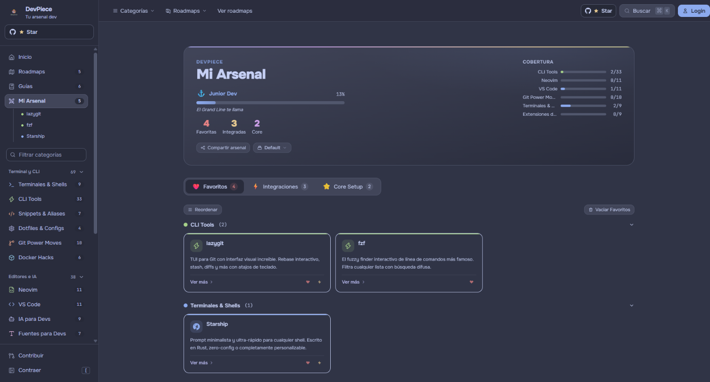
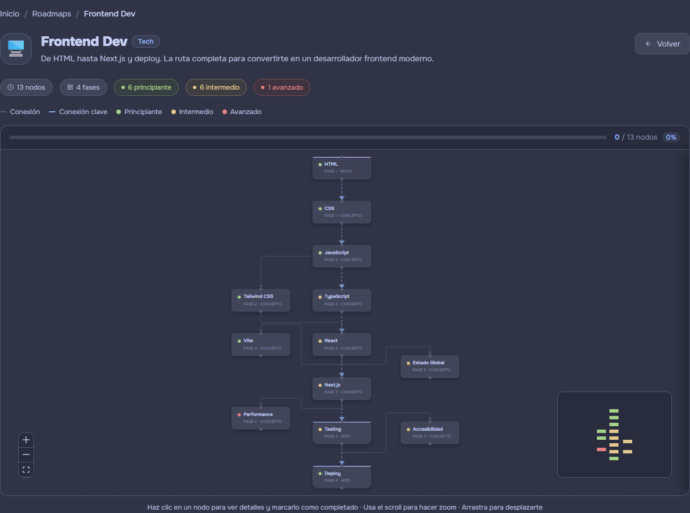
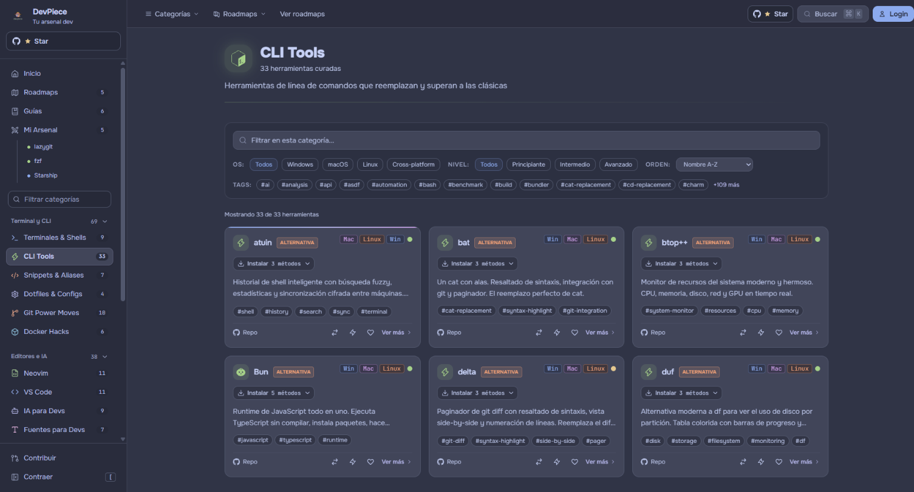
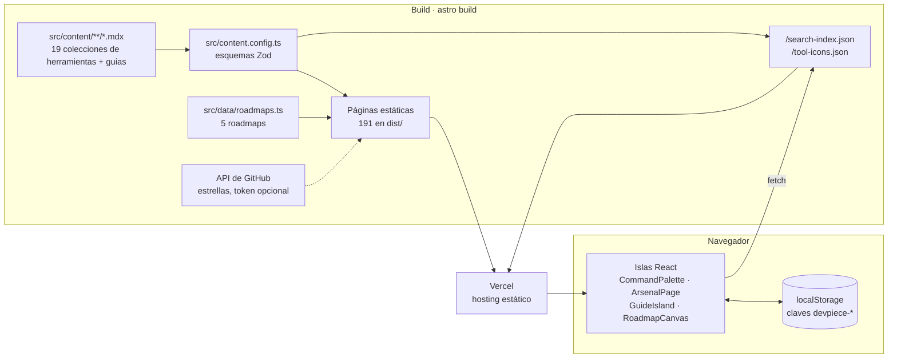

<div align="center">



# DevPiece

**Hub estático de herramientas, guías y roadmaps para desarrolladores, en español.**

[](https://github.com/mkcodev/dev-piece/issues/19)
[](LICENSE)
[](https://github.com/mkcodev/dev-piece/actions/workflows/ci.yml)
[](https://astro.build)
[](https://react.dev)
[](https://www.typescriptlang.org)
[](https://v3.tailwindcss.com)
[](https://pnpm.io)

[Demo](https://devpiece.vercel.app) · [Documentación](docs/) · [Reportar un bug](https://github.com/mkcodev/dev-piece/issues/new?template=bug.md)

</div>



<!-- TODO: cuando se fusione #19, abrir otro issue y PR para añadir la captura de la home nueva y las puntuaciones de Lighthouse. -->

<details>
<summary>🇬🇧 English summary</summary>

DevPiece is a static, Spanish-language hub of curated developer tools, interactive step-by-step guides and learning roadmaps.
There is no backend or database: your personal "Mi Arsenal" collection and your progress live in the browser's `localStorage`.
Content is MDX validated with Zod at build time. The site is built with Astro 6, React 19 islands, Tailwind CSS 3.4, Fuse.js for search and React Flow for the roadmaps.

</details>

## Contenido

- [¿Por qué existe?](#-por-qué-existe)
- [Funcionalidades](#-funcionalidades)
- [Stack](#-stack)
- [Arquitectura](#-arquitectura)
- [Decisiones técnicas](#-decisiones-técnicas)
- [Calidad](#-calidad)
- [Desarrollo con IA](#-desarrollo-con-ia)
- [Empezar](#-empezar)
- [Roadmap](#-roadmap)
- [Autor](#-autor)
- [Licencia](#-licencia)

## 🎯 ¿Por qué existe?

Las herramientas, configuraciones y trucos de terminal, editor y Git están repartidos entre blogs, repositorios y hilos, y casi todo está en inglés.

DevPiece los reúne en un catálogo curado en español, con comandos de instalación por gestor de paquetes, guías con pasos marcables y roadmaps de aprendizaje. Está pensado para desarrolladores que quieren montar su entorno sin buscar cada pieza por separado. Antes se llamaba DevVault.

## ✨ Funcionalidades

| Funcionalidad | Qué aporta | Estado |
|---|---|---|
| Catálogo de herramientas | 155 herramientas en 19 categorías, con comandos de instalación por gestor (`winget`, `scoop`, `choco`, `brew`, `apt`, `cargo`, `npm`, `pnpm`, `pip`), filtros por sistema operativo y nivel, etiquetas y orden | Hecho |
| Guías interactivas | 6 guías con pasos que se marcan como hechos, barra de progreso, «guía rápida» con los comandos y favoritas | Hecho |
| Roadmaps | 5 roadmaps (3 de tecnología y 2 de herramientas) sobre un lienzo de React Flow, con descripción, dificultad y recursos por nodo, y progreso guardado | Hecho |
| Mi Arsenal | Favoritos, integraciones y «Core Setup» (las herramientas que están en ambas listas), perfiles, reordenar arrastrando, compartir por URL y exportar un script `.sh` o `.ps1` | Hecho |
| Arsenal Power | Rango de 6 niveles (de *Rookie Dev* a *Pirate King*) calculado a partir del arsenal, con aviso al subir de rango | Hecho |
| Búsqueda | Paleta <kbd>Ctrl</kbd>+<kbd>K</kbd> / <kbd>⌘</kbd>+<kbd>K</kbd> con búsqueda difusa (Fuse.js) sobre un índice generado en el build | Hecho |
| Navegación | Barra lateral con grupos plegables y filtro de categorías, y cajón con la misma funcionalidad en móvil | Hecho |
| Perfil local | Nombre y foto guardados en el navegador, sin autenticación | Hecho |
| Mejoras de UX (Fase 6) | Corrección del CLS de `/arsenal`, iconos Lucide, imagen OG y hero de la home ([#19](https://github.com/mkcodev/dev-piece/issues/19)) | En curso |

> [!NOTE]
> No hay cuentas ni servidor: el arsenal, los perfiles y el progreso de guías y roadmaps viven solo en el `localStorage` del navegador. Borrar los datos del sitio los borra.

<details>
<summary>Más capturas</summary>

<br>



<br>



</details>

## 🧰 Stack

| Capa | Tecnología | Por qué |
|---|---|---|
| Framework | Astro 6 (`output: 'static'`) | Genera un sitio 100% estático, sin backend |
| UI interactiva | React 19 (islas con `client:load` / `client:visible`) | Solo se hidrata lo interactivo; las páginas son Astro estático |
| Contenido | MDX, Content Collections y Zod | El frontmatter se valida en el build y un error lo hace fallar |
| Búsqueda | Fuse.js 7 | Búsqueda difusa en el cliente sobre `/search-index.json` |
| Roadmaps | `@xyflow/react` 12 | Lienzo con nodos y aristas definidos en `src/data/roadmaps.ts` |
| Estilos | Tailwind CSS 3.4, paleta Catppuccin Frappé | Tokens como variables CSS y un color de acento por categoría |
| Tipografía e iconos | Onest y JetBrains Mono (Fontsource), Lucide y simple-icons | Autoalojados: no dependen de un CDN |
| Código | Shiki (`catppuccin-frappe`) | Resaltado de los bloques de código en el build |
| Testing y CI | GitHub Actions | `pnpm build` en cada PR; no hay suite de tests |
| Herramientas | pnpm 9, Node ≥ 22.12, Vercel | Gestor de paquetes y despliegue con preview por PR |

## 🧱 Arquitectura



La página `/search` carga Fuse.js desde jsDelivr en el navegador (`src/pages/search.astro`); el resto de peticiones del cliente van al propio sitio.

```text
.
├── .github/          Plantillas de issue y PR, y workflows/ci.yml
├── docs/             FLUJO.md (flujo de trabajo) y assets/ (capturas de este README)
├── public/           Logo y favicons
├── src/
│   ├── components/   Islas React y componentes Astro (arsenal, guias, roadmaps, search, tools, layout, common)
│   ├── content/      19 carpetas de herramientas en MDX y guias/
│   ├── data/         roadmaps.ts: nodos y aristas de los 5 roadmaps
│   ├── layouts/      BaseLayout y CategoryLayout
│   ├── lib/          CATEGORY_CONFIG (utils.ts), acceso al contenido, índice de búsqueda, iconos y GitHub
│   ├── pages/        Rutas: [category], guias, roadmaps, arsenal, search y los JSON de índice e iconos
│   ├── scripts/      motion.ts (animaciones) y nav.ts
│   ├── styles/       globals.css, nav.css y transitions.css
│   └── content.config.ts   Colecciones y esquemas Zod
├── astro.config.mjs  Astro, MDX, React, sitemap y Shiki
├── tailwind.config.mjs
└── CLAUDE.md         Guía del proyecto para Claude Code
```

## 🧭 Decisiones técnicas

<details>
<summary><strong>1. Sitio estático con el estado en <code>localStorage</code></strong></summary>

- **Contexto:** el catálogo es contenido curado que no cambia por usuario, y se quiere evitar cuentas, servidor y base de datos.
- **Decisión:** todo se genera en el build (`output: 'static'`). El arsenal, los perfiles y el progreso viven en `localStorage`, y las islas React los leen y escriben.
- **Consecuencia:** no hay nada que mantener en servidor. A cambio, los datos no se sincronizan entre dispositivos; para moverlos hay «Compartir arsenal» (URL con `?share=` codificada en base64) y la exportación a script.

</details>

<details>
<summary><strong>2. El build como validación del contenido</strong></summary>

- **Contexto:** el catálogo crece con archivos MDX escritos a mano y no hay suite de tests.
- **Decisión:** `src/content.config.ts` define un esquema Zod por colección (`toolSchema` y `guiaSchema`). Las referencias `related` a una herramienta inexistente lanzan error en el build.
- **Consecuencia:** un frontmatter inválido hace fallar `pnpm build`, y la CI ejecuta ese comando en cada PR. La validación cubre el contenido; la interfaz no tiene pruebas automáticas.

</details>

<details>
<summary><strong>3. <code>CATEGORY_CONFIG</code> como registro único de categorías</strong></summary>

- **Contexto:** las categorías se usan en rutas, barra lateral, listados y búsqueda.
- **Decisión:** `CATEGORY_CONFIG` en `src/lib/utils.ts` es el registro. El enrutado (`[category]/index.astro` y `[category]/[slug].astro`), la barra lateral, `getAllTools()` y el índice de búsqueda iteran sus claves. `guias` queda fuera a propósito: tiene sus propias rutas y no entra en el índice.
- **Consecuencia:** añadir una categoría exige una colección en `content.config.ts` y una entrada en `CATEGORY_CONFIG`. Si falta la colección, el `try/catch` la traga y la categoría sale vacía.

</details>

<details>
<summary><strong>4. Claves <code>devpiece-*</code> como contrato con los usuarios</strong></summary>

- **Contexto:** los datos de los usuarios están en `localStorage` y cada herramienta se guarda por `category` y `slug`.
- **Decisión:** las claves `devpiece-*` no se renombran. Al cambiar el nombre del proyecto de DevVault a DevPiece, un script en línea de `BaseLayout.astro` migra las claves `devvault-*` a `devpiece-*` antes de hidratar las islas.
- **Consecuencia:** renombrar un MDX o una categoría cambia la URL y rompe los arsenales guardados. Por eso [`docs/FLUJO.md`](docs/FLUJO.md) lo marca como regla del proyecto.

</details>

<details>
<summary><strong>5. Roadmaps como datos TypeScript, no como MDX</strong></summary>

- **Contexto:** cada nodo del lienzo de React Flow necesita posición, aristas, fase, dificultad y recursos.
- **Decisión:** los 5 roadmaps son datos tipados con interfaces en `src/data/roadmaps.ts` (`RoadmapDef`, `RoadmapNode`, `RoadmapEdge`), renderizados por `RoadmapCanvas.tsx`. Los nodos pueden enlazar a fichas del catálogo con `devpieceLink`.
- **Consecuencia:** añadir un roadmap implica tocar código. No pasan por Zod, así que su estructura la comprueban los tipos de TypeScript y no el esquema de contenido.

</details>

## ✅ Calidad

- **Tests:** no hay suite de tests, ni linter ni formateador configurados (`package.json`: scripts `dev`, `build`, `preview` y `astro`).
- **CI:** [GitHub Actions](.github/workflows/ci.yml) ejecuta `pnpm install --frozen-lockfile` y `pnpm build` en Node 22, en cada pull request y en cada push a `main`.
- **Build:** `pnpm build` sobre `main` (commit `c927a82`, 2026-11-12) termina sin errores y genera 191 páginas. Ese build valida el frontmatter con los esquemas Zod.
- **Flujo:** issue, rama, pull request con `Closes #N`, CI en verde y squash merge. Hay 8 pull requests fusionadas y 11 commits en `main`. Ver [`docs/FLUJO.md`](docs/FLUJO.md).
- **Despliegue:** Vercel genera una preview por PR y publica en producción al fusionar con `main`.

<!-- TODO: añadir puntuaciones de Lighthouse (Rendimiento, Accesibilidad, Buenas prácticas y SEO) cuando se fusione #19 y se midan con `pnpm build`, `pnpm preview` y `npx lighthouse`. -->

## 🤖 Desarrollo con IA

El repositorio incluye [`CLAUDE.md`](CLAUDE.md), la guía del proyecto para Claude Code. Esto es lo que consta en el historial:

- **Trazabilidad:** 2 de los 11 commits de `main` llevan el trailer `Co-Authored-By: Claude Sonnet 4.6` (`git log --grep`, 2026-11-12). El resto no lleva trailer, así que el historial no permite medir qué parte del código se generó con IA.
- **Revisión:** cada cambio pasa por un issue, una rama y una pull request con plantilla, y no se fusiona con la CI en rojo. Ver [`docs/FLUJO.md`](docs/FLUJO.md).
- **Red de seguridad:** el build con validación Zod en cada PR. No hay tests automáticos.

## 🚀 Empezar

**Requisitos:** Node 22.12 o superior y pnpm 9.

```bash
git clone https://github.com/mkcodev/dev-piece.git
cd dev-piece
pnpm install
pnpm dev        # http://localhost:4321
```

Otros comandos:

```bash
pnpm build      # build estático en ./dist; valida el contenido con Zod
pnpm preview    # sirve el build
```

**Añadir una herramienta:** crea `src/content/<categoria>/<slug>.mdx` con el frontmatter del esquema (obligatorios: `name`, `description` de hasta 200 caracteres, `category`, `tags`, `os` y `addedAt`) y ejecuta `pnpm build` para validarlo.

El sitio no necesita variables de entorno, así que no hay `.env.example`. Hay una opcional:

| Variable | Para qué |
|---|---|
| `GITHUB_TOKEN` | Opcional. Autentica la petición a la API de GitHub que obtiene el número de estrellas durante el build (`src/lib/github.ts`) |

> [!TIP]
> Sin `GITHUB_TOKEN` el build funciona igual: la petición va sin autenticar y, si falla, no se muestra el contador de estrellas.

## 📍 Roadmap

- [x] Renombrado de DevVault a DevPiece ([#1](https://github.com/mkcodev/dev-piece/issues/1))
- [x] Flujo de trabajo con plantillas, CI y `docs/FLUJO.md` ([#7](https://github.com/mkcodev/dev-piece/issues/7))
- [x] Sistema de diseño ([#9](https://github.com/mkcodev/dev-piece/issues/9)) y barra lateral con paridad móvil ([#11](https://github.com/mkcodev/dev-piece/issues/11))
- [x] Desplegable de instalación multi-gestor e iconos autoalojados ([#13](https://github.com/mkcodev/dev-piece/issues/13))
- [x] Animaciones ([#15](https://github.com/mkcodev/dev-piece/issues/15)) y ampliación del contenido a 155 herramientas ([#17](https://github.com/mkcodev/dev-piece/issues/17))
- [ ] Fase 6 de UX: CLS de `/arsenal`, imagen OG, iconos Lucide, hero de la home y Lighthouse ([#19](https://github.com/mkcodev/dev-piece/issues/19))

## 👤 Autor

**Mikel Salvador** · AI-Augmented Full-Stack Developer

[LinkedIn](https://linkedin.com/in/mkcodev) · [Web](https://mkcodev.com) · [info@mkcodev.com](mailto:info@mkcodev.com)

## 📄 Licencia

MIT (ver [LICENSE](LICENSE)).

<br>

<div align="center">

Made with ❤️ by [mkcodev](https://mkcodev.com) · AI-Augmented Full-Stack Developer

</div>
